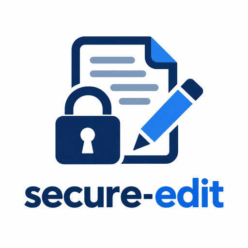
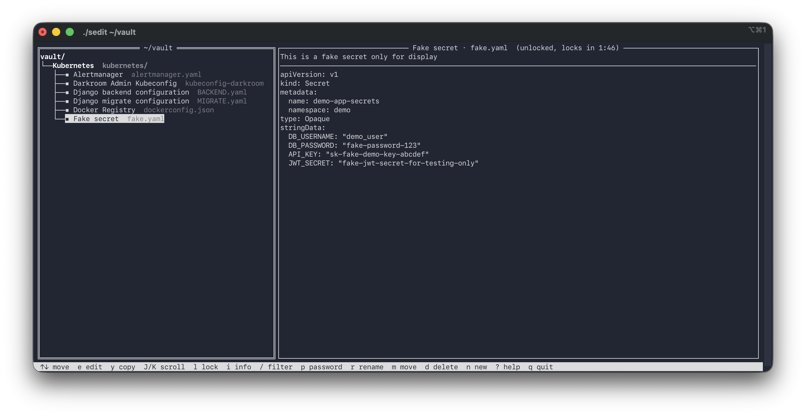
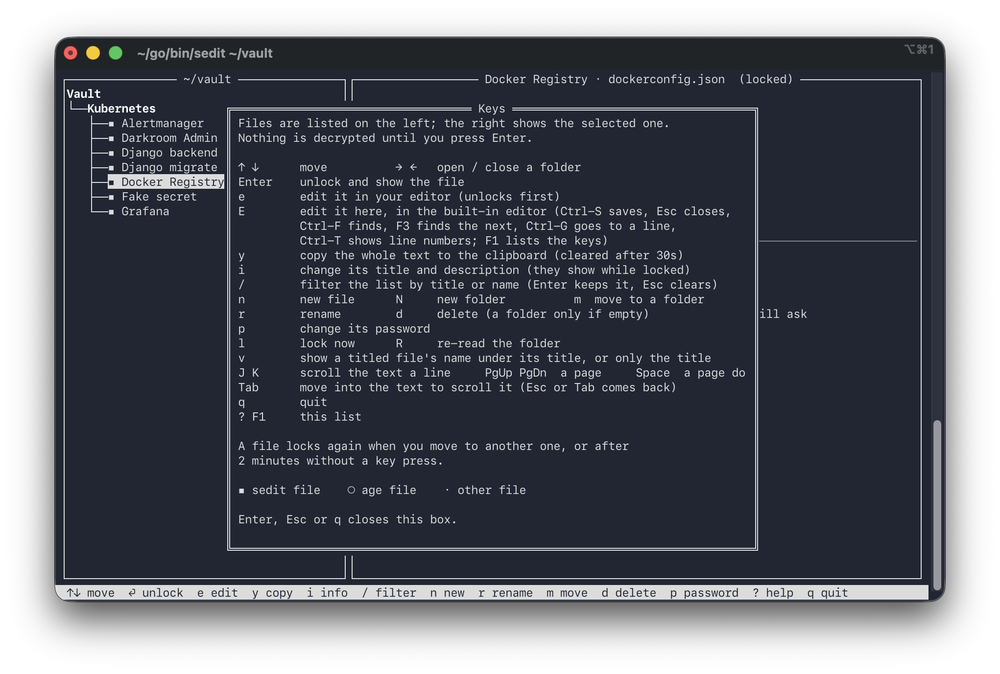
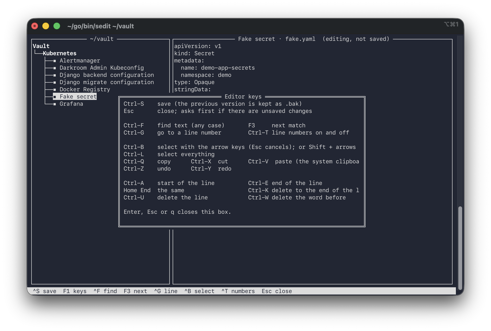

# secure-edit



Keep notes, credentials and other text in files encrypted with a passphrase.
Browse them in a full-screen terminal interface, edit them in your own editor, and
share them safely with others.

`secure-edit` a.k.a. `sedit` uses authenticated encryption, so a wrong password
is rejected **before** the editor opens, and any tampering with a file is
detected. Nothing is decrypted until you ask, and what is open locks itself again.

<br clear="right">

<p align="center">
  
</p>

## Quick start

```sh
sedit ~/secrets        # open the interface on a folder
sedit                  # ...or on $SEDIT_HOME, if set, otherwise the current folder
```

The list on the left shows your files and folders; the preview on the right stays
**locked** until you press Enter. The keys you need first:

| Key | Does |
|-----|------|
| `⏎` | Unlock the selected file and show it (a folder opens or closes) |
| `e` | Edit it in your editor (`$SEDIT_EDITOR`, `$VISUAL`, `$EDITOR`, or vim) |
| `E` | Edit it in the built-in editor (`Ctrl-S` save, `Ctrl-F` find, `Ctrl-B` select, `Ctrl-Q` copy) |
| `y` | Copy the text to the clipboard, cleared again after 30 seconds |
| `x` | Export a copy for someone else, encrypted to their public key (a file or text to paste) |
| `n` `N` | New file, new folder (each with an optional title and description) |
| `/` | Filter the list by title or name |
| `?` `q` | All the keys, quit |

Press `?` in the interface for the rest. It is described in full in
[docs/interface.md](docs/interface.md).

The same program is also a command-line tool, for single files and for scripts:

```sh
sedit notes.txt                          # edit one file (created if new)
sedit -p notes.txt | grep api            # print it
echo "new line" | sedit --append notes.txt
sedit --share notes.txt --to age1...     # a copy someone else opens with "age"
```

See [docs/command-line.md](docs/command-line.md).

## Features

- **Locked by default.** The interface decrypts a file only when you press Enter,
  re-locks it when you move on or after two minutes without a key, and wipes the
  text and the password from memory when it does.
- **Strong encryption:** XChaCha20-Poly1305 with a key derived from your
  passphrase by Argon2id (3 passes, 256 MiB, 4 threads).
- **Wrong password fails early:** the file is authenticated and decrypted before the
  editor launches. No more editing garbage. The whole header, including the KDF
  parameters, is authenticated, so tampering is detected.
- **Your editor:** `$SEDIT_EDITOR`, then `$VISUAL`, then `$EDITOR`, then vim.
  Graphical editors in `$VISUAL` or `$EDITOR` are ignored, because they keep
  plaintext copies (see [Choosing an editor](docs/command-line.md#choosing-an-editor)).
  For vim, vi and nvim, `sedit` also turns off swap, backup, undo and viminfo
  files and shows a `SEDIT ENCRYPTED` banner so you know you are in a sedit session.
- **A built-in editor too:** `E` edits the text right in the interface, with find,
  go to line, line numbers and copy and paste through the system clipboard (cleared
  after 30 seconds), and no other program or temp file involved. `e` still uses your
  own editor. All its keys are in [the interface](docs/interface.md).
- **Titles, descriptions and folders.** Give a file or folder a title and a
  description that show while it is locked, and organise files in folders you can
  make, rename, move and delete from the interface. File labels are stored in the
  clear; see [Titles and descriptions](docs/command-line.md#titles-and-descriptions).
- **Find things:** `/` filters by title or name across the whole tree.
- **Safe saves:** written atomically, with the previous version kept (still
  encrypted) as `FILE.bak`. A lock stops two `sedit` processes editing the same file.
- **Clipboard with a timer:** copied text is cleared again after 30 seconds, and at
  once when you quit, but only if you haven't copied something else since.
- **Sharing:** `sedit --share` writes a copy encrypted to someone's age or SSH
  public key, which they open with the standard `age` tool and no `sedit`;
  `sedit --import` turns such a file into one you can edit; `--keygen` makes the key.
- **Piping and scripting:** `--write`, `--append` and `-p`, with no editor.
- **Tidy file management:** `--mv` and `--rm` move and delete a file together with
  its backup and remembered password, which a plain `mv` or `rm` would leave behind.
- **Optional Keychain support (macOS, opt-in):** remember a file's password, or a
  default for new files, in the login keychain. Off unless you ask; see
  [docs/keychain.md](docs/keychain.md) for the trade-off.

## Install

### From a release

Download the tarball for your platform (macOS or Linux, arm64 or amd64) from the
[Releases page](https://github.com/eddienko/secure-edit/releases), check it
against `SHA256SUMS`, and put `sedit` somewhere on your `PATH`:

```sh
shasum -a 256 -c --ignore-missing SHA256SUMS
tar -xzf sedit_v1.0.0_darwin_arm64.tar.gz
mv sedit_v1.0.0_darwin_arm64/sedit /usr/local/bin/
sedit --version
```

The binaries are not code-signed or notarized. If macOS refuses to open one
downloaded in a browser ("cannot be opened because the developer cannot be
verified"), clear the quarantine flag with `xattr -d com.apple.quarantine sedit`,
or build from source instead. Releases are built by a GitHub Actions workflow
when a `v*` tag is pushed.

### From source

Requires Go 1.26 or newer (an older Go with `GOTOOLCHAIN=auto`, the default,
downloads it automatically).

With `go install`, which puts `sedit` in `$(go env GOBIN)` (default `~/go/bin`):

```sh
go install github.com/eddienko/secure-edit/cmd/sedit@latest
```

Or from a clone:

```sh
git clone https://github.com/eddienko/secure-edit.git
cd secure-edit
go build -o sedit ./cmd/sedit
# optionally: mv sedit /usr/local/bin/
```

## Read more

- [The interface](docs/interface.md): the keys, locking, the clipboard, folders,
  titles and the filter.
- [Command line](docs/command-line.md): editing, printing, piping, sharing, moving
  and deleting files, and scripting.
- [Remembering passwords](docs/keychain.md): the macOS Keychain, per file or as a
  default.
- [Security and file format](docs/security.md): what `sedit` protects, what it
  does not, and how the files are laid out. **Read this before relying on it.**
- [Development](docs/development.md): project layout, tests and how to publish a
  version.
- [Roadmap](docs/roadmap.md): ideas for later, such as a recovery key for a forgotten
  password.

## More screenshots

The list of keys in the interface (`?` or `F1`):

<p align="center">
  
</p>

Editing in the built-in editor (`E`), with its own key list (`F1`):

<p align="center">
  
</p>

## License

[MIT](LICENSE) © 2026 Eduardo Gonzalez Solares
